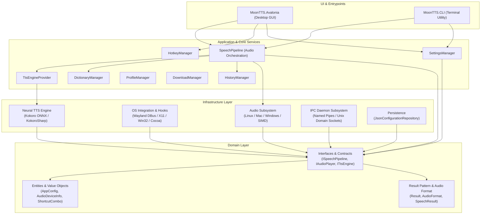
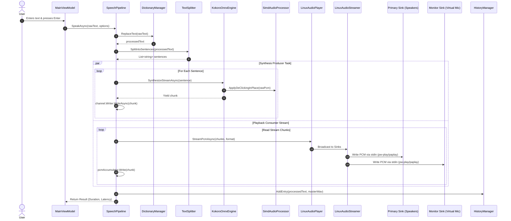
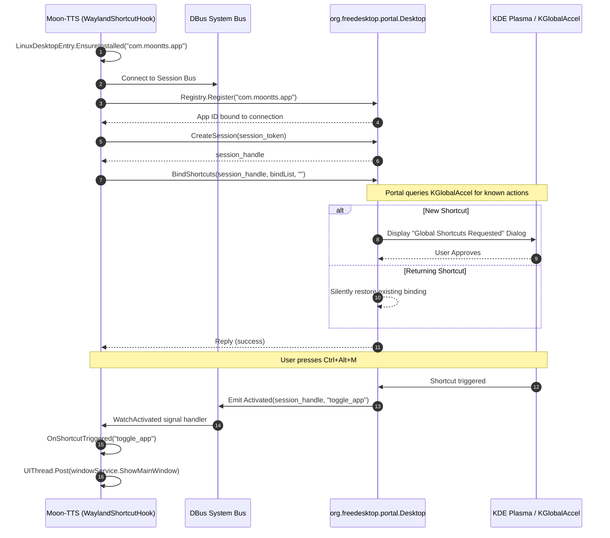

# Moon-TTS: System Architecture & Technical Specification

> **Repository**: **Moon-TTS-CS**  
> **Target Framework**: .NET 10.0 (100% Native AOT Compiled)  
> **UI Framework**: Avalonia UI 11.2 (Fluent / Cross-Platform Desktop / Software Rendering / Single-Instance)  
> **Neural Engine**: Kokoro TTS (ONNX Runtime via KokoroSharp)  
> **Audio Architecture**: Zero-Copy PCM Streaming, Dual-Device Output, Virtual Loopback Microphone, SIMD DSP  

---

## 1.Overview, Purpose & Scope

### 1.1 Purpose of the Application
**Moon-TTS** is a high-performance, local Text-to-Speech (TTS) desktop and command-line **accessibility** application built in C# with Domain-Driven Design (DDD) in mind. It is designed to provide as little latency as possible, and decent quality offline speech synthesis with real-time dual-output audio routing. While mainly thought for its use with small, local LLM based speech synthesis, it's also possible to use regular text-to-phoneme synthesizers. 

### 1.2 Target Use Cases
1. **Live Voice Chat & Gaming:
   - Routes synthesized audio directly into a virtual microphone sink (`MoonTTS Virtual Microphone`) so that applications like Zoom, Discord, TeamSpeak, OBS, or in-game voice chat hear the user's TTS voice as real microphone input.
   - Simultaneously plays the identical audio stream through the user's headphones / monitor output with independent volume control, allowing the user to hear what they are saying without feedback loops or echo.
1. **Instant Desktop Text-to-Speech (GUI Mode)**:
   - A floating, frameless, transparent-backgroud display that can be opened or hidden instantly from anywhere in the OS via a global shortcut (E.g. `Ctrl+Alt+M`).
   - Supports "Type & Enter" speech with immediate sentence-streamed audio playback.
1. **Hotkey Phrase Library**:
   - Enables users to bind global system hotkeys to pre-synthesized audio phrases (or on-the-fly speech) across multiple isolated profiles for rapid shortcut swapping.
1. **Phonetic & Slang Correction Dictionary**:
   - Real time word substitution engine using compiled longest-match regex to correct pronunciation of unusual names, acronyms, and phonetic quirks before passing text to the TTS engine.
1. **Headless CLI & Daemon Operation**:
   - Complete terminal interface (`mtts`) capable of managing models, configuring outputs, synthesizing speech, or delegating work to an idle-auto-terminating background IPC daemon.

### 1.3 What Moon-TTS Is not
- **Not a Cloud TTS Client**: Moon-TTS does not rely on third-party cloud APIs (ElevenLabs, Azure, AWS Polly, Google Cloud TTS). It performs 100% offline local inference on the host machine and will not collect, share or connect to the internet for anything besides downloading optional TTS engines directly from their source.
- **Not a Screen Reader**: It is not an alternative to NVDA, JAWS, or Orca. It does not hook accessibility trees, focus change events, or OS navigation. It is an on-demand voice synthesizer.
- **Not a Digital Audio Workstation (DAW)**: It does not support multi-track editing, MIDI sequencing, or VST plugins. Its audio pipeline is optimized strictly for low-latency voice streaming, de-clicking, and output routing.

---

## 2. Architectural Principles & Solution Structure

Moon-TTS is structured according to **Clean Architecture** and **Domain-Driven Design (DDD)**. Dependencies strictly flow inward: UI and Infrastructure depend on Core and Domain; Domain depends on nothing.



---

## 3. Complete File Tree & File Responsibilities

### 3.1 Solution Root
* **Directory.Build.targets**: Central MSBuild properties and build targets across all solution projects.
* **MoonTTS.slnx**: Solution definition linking Domain, Core, Infrastructure, Avalonia, and CLI.
* **README.md**: Project overview and quickstart guide.

---

### 3.2 MoonTTS.Domain (`MoonTTS.Domain/`)
The foundational domain layer containing pure domain models, business logic contracts, value objects, and zero third-party framework dependencies.

#### Common & Result Pattern
* **MoonTTS.Domain/Common/Result.cs**: Non-generic functional result type encapsulating operation success/failure status and error messages without throwing exceptions for control flow.
* **MoonTTS.Domain/Common/Result< T >.cs**: Generic functional result type encapsulating a strongly typed payload `Value` or an error message and exception.

#### Audio Contracts
* **MoonTTS.Domain/Audio/AudioFormat.cs**: Value record defining PCM audio geometry (sample rate, channels, bit depth) and audio byte duration calculation (`GetDuration`).
* **MoonTTS.Domain/Audio/SpeechOptions.cs**: Options parameter object governing speech synthesis execution (speed override, playback enablement, volume overrides, dictionary enablement, history capture, and optional WAV export path).
* **MoonTTS.Domain/Audio/SpeechResult.cs**: Metric record returned upon speech synthesis completion containing audio duration, time-to-first-sound latency, and total PCM bytes produced.

#### Entities
* **MoonTTS.Domain/Entities/AppConfig.cs**: Core application configuration entity storing model selection, volume levels, dual audio output device IDs, window positioning preferences, startup behavior, and global hotkeys.
* **MoonTTS.Domain/Entities/AudioDeviceInfo.cs**: Entity representing a discovered system audio output sink or virtual microphone (Device ID and display name).
* **MoonTTS.Domain/Entities/DictionaryEntry.cs**: Entity representing a word replacement rule (Original word, replacement spelling, case-sensitivity flag).
* **MoonTTS.Domain/Entities/HistoryEntry.cs**: Entity representing a recorded speech event with a unique ID, trimmed text preview, timestamp, and associated WAV audio file reference (`WavFileName`).
* **MoonTTS.Domain/Entities/HotkeyEntry.cs**: Entity mapping a key combination string to a pre-synthesized audio phrase.
* **MoonTTS.Domain/Entities/HotkeyProfile.cs**: Entity representing an isolated hotkey soundboard profile with its isolated folder name on disk.
* **MoonTTS.Domain/Entities/KokoroEngineConfig.cs**: Engine-specific configuration entity storing the selected Kokoro voice ID and baseline speech speed.
* **MoonTTS.Domain/Entities/ProfileDataStore.cs**: Persistence container holding the list of all configured profiles and the name of the currently active profile.

#### Enums & Constants
* **MoonTTS.Domain/Enums/KokoroVoiceId.cs**: Enumeration of all built-in Kokoro voice weights (American/British female & male voices: `af_heart`, `am_adam`, `bf_emma`, etc.).
* **MoonTTS.Domain/Enums/TtsModelType.cs**: Enumeration of supported TTS neural models (`Kokoro`, `Kokoro_fp16`, `Kokoro_zh_fp16`).
* **MoonTTS.Domain/Constants/AppConstants.cs**: Solution-wide boundaries and limits (e.g. maximum history entries, maximum hotkey bindings).

#### Value Objects
* **MoonTTS.Domain/ValueObjects/ModelMetadata.cs**: Immutable metadata describing a neural model (model type, display name, description, file requirements, download URLs, and sizes).
* **MoonTTS.Domain/ValueObjects/ShortcutCombo.cs**: Immutable value object parsing and validating key combinations (Ctrl, Alt, Shift, Win + Main Key) with equality comparison and standard string formatting.

#### Interfaces
* **MoonTTS.Domain/Interfaces/IAudioPlayer.cs**: Contract for cross-platform audio playback, device enumeration, dual output sink targeting, volume attenuation, pause/resume, and strongly-typed raw PCM streaming (`StreamPcmAsync`, `PlayPcmAsync`).
* **MoonTTS.Domain/Interfaces/IEngineConfig.cs**: Marker interface for polymorphic engine-specific settings.
* **MoonTTS.Domain/Interfaces/IGlobalShortcutHook.cs**: Contract for platform-specific global keyboard hook services.
* **MoonTTS.Domain/Interfaces/IModelDownloader.cs**: Contract for streaming chunked downloads of neural model ONNX weights and voice files.
* **MoonTTS.Domain/Interfaces/IModelRegistry.cs**: Contract cataloging supported models and their downloadable file assets.
* **MoonTTS.Domain/Interfaces/IConfigurationRepository.cs**: Centralized contract for persisting and retrieving application settings, engine configurations, phonetic dictionary rules, soundboard profiles, hotkeys, and speech history, along with granular change notification events.
* **MoonTTS.Domain/Interfaces/ISpeechPipeline.cs**: Central contract orchestrating dictionary preprocessing, parallel sentence synthesis, audio streaming, history capture, and cancellation.
* **MoonTTS.Domain/Interfaces/ITtsEngine.cs**: Contract implemented by neural TTS backends for text-to-PCM stream generation, voice management, and format description.
* **MoonTTS.Domain/Interfaces/ITtsEngineFactory.cs**: Factory contract producing initialized **ITtsEngine** instances.
* **MoonTTS.Domain/Interfaces/ITtsEngineProvider.cs**: State holder providing the currently active TTS engine and managing model switching.

---

### 3.3 MoonTTS.Core (`MoonTTS.Core/`)
The application service layer implementing business workflows, coordinating managers, and providing domain utilities.

#### Services
* **MoonTTS.Core/Services/SpeechPipeline.cs**: Central coordinator of the speech lifecycle. Preprocesses text via **DictionaryManager**, splits text via **TextSplitter**, spawns a producer task feeding a bounded `Channel<ReadOnlyMemory<byte>>`, streams PCM chunks to **IAudioPlayer**, accumulates PCM bytes for history recording, and writes optional export WAV files via **WavWriter**.
* **MoonTTS.Core/Services/SettingsManager.cs**: Application facade over **IConfigurationRepository**. Coordinates cached access to **AppConfig** and polymorphic engine configurations, forwarding repository updates as unified `SettingsChanged` events.
* **MoonTTS.Core/Services/HotkeyManager.cs**: Manages phrase hotkeys and the primary toggle hotkey. Persists bindings through **IConfigurationRepository**, pre-synthesizes audio for phrases via the speech pipeline, and plays pre-rendered WAV files through **IAudioPlayer** using format detection via **FormatReader**.
* **MoonTTS.Core/Services/DictionaryManager.cs**: High-performance word substitution engine. Manages entries via **IConfigurationRepository**, compiling words sorted by descending length into a single unified regex with word boundary detection (`\b`) for O(N) single-pass text preprocessing.
* **MoonTTS.Core/Services/HistoryManager.cs**: Manages audio history cache. Enforces maximum entry limits (`MaxHistoryEntries`), persists metadata via **IConfigurationRepository**, writes generated master WAV files to `audio/history/`, purges oldest files upon overflow, and replays history audio via **FormatReader** and **IAudioPlayer**.
* **MoonTTS.Core/Services/ProfileManager.cs**: Manages hotkey soundboard profiles and profile switching through **IConfigurationRepository**, sanitizing profile folder names and guaranteeing a valid `Default` fallback profile.
* **MoonTTS.Core/Services/TtsEngineProvider.cs**: Manages active engine lifetime. Dynamically resolves engines via **ITtsEngineFactory**, validates model availability with **DownloadManager**, and gracefully falls back to **EmptyTtsEngine** if models are unselected or missing.
* **MoonTTS.Core/Services/DownloadManager.cs**: Orchestrates model file verification, chunked downloading with progress reporting, and safe file deletion (preventing deletion of shared voice tensors used by other models), resolving directories via **IConfigurationRepository** and **PathResolver**.

#### Utilities & Helpers
* **MoonTTS.Core/Utilities/FormatReader.cs**: Extracts audio format parameters (`SampleRate`, `Channels`, `BitDepth`) dynamically from standard RIFF/WAV headers (`byte[]` or `ReadOnlySpan<byte>`), avoiding hardcoded engine format assumptions.
* **MoonTTS.Core/Utilities/PathResolver.cs**: Resolves platform-specific configuration and model directories (`~/.config/moontts` on Linux, `%APPDATA%\moontts` on Windows).
* **MoonTTS.Core/Utilities/PathSanitizer.cs**: Sanitizes user-provided profile names to create safe disk directories across OS file systems.
* **MoonTTS.Core/Utilities/TextSplitter.cs**: Splits lengthy sentences by punctuation delimiters (`.`, `!`, `?`, `;`, `,`) to enable low-latency sentence-by-sentence streaming.
* **MoonTTS.Core/Utilities/WavWriter.cs**: Writes standard 44-byte RIFF/WAVE headers for raw 16-bit PCM byte spans without allocating intermediate stream overhead.
* **MoonTTS.Core/Helpers/EmptyTtsEngine.cs**: Null-object implementation of **ITtsEngine** used when no engine is loaded or model files are unavailable.

---

### 3.4 MoonTTS.Infrastructure (`MoonTTS.Infrastructure/`)
Low-level adapters implementing system-level functionality for audio drivers, OS global shortcuts, ONNX neural inference, background IPC daemons, and storage.

#### Audio Subsystem
* **MoonTTS.Infrastructure/Audio/AudioPlayerManager.cs**: Factory that instantiates the operating-system-specific **IAudioPlayer** implementation (`LinuxAudioPlayer` on Linux/macOS, `WindowsAudioPlayer` on Windows).
* **MoonTTS.Infrastructure/Audio/SimdAudioProcessor.cs**: High-performance digital signal processing (DSP) operating in-place on raw PCM `Span<byte>` without memory allocations. Performs volume scaling and boundary de-clicking (fade-in / fade-out smoothing).
* **MoonTTS.Infrastructure/Audio/Linux/LinuxAudioPlayer.cs**: Linux audio player supporting dual sink playback (Primary + Monitor), sink enumeration, and loopback microphone integration.
* **MoonTTS.Infrastructure/Audio/Linux/LinuxAudioStreamer.cs**: Manages active child playback processes, streaming zero-copy PCM chunks into `stdin` of `pw-play` or `paplay`.
* **MoonTTS.Infrastructure/Audio/Linux/LinuxDeviceEnumerator.cs**: Native sink discovery parser parsing `pactl list sinks short` and `wpctl status` for PipeWire/PulseAudio environments.
* **MoonTTS.Infrastructure/Audio/Linux/LinuxProcessRunner.cs**: Process execution harness launching `pw-play` or `paplay` with appropriate sample format flags.
* **MoonTTS.Infrastructure/Audio/Linux/LinuxVirtualMicService.cs**: Manages lifecycle of the PipeWire/PulseAudio null-sink virtual microphone (`MoonTTS_Virtual_Mic`).
* **MoonTTS.Infrastructure/Audio/WindowsAudioPlayer.cs**: Windows audio player adapter utilizing WASAPI / PowerShell audio fallback.
* **MoonTTS.Infrastructure/Audio/MacOS/MacAudioPlayer.cs**: macOS audio player adapter using CoreAudio / `afplay`.
* **MoonTTS.Infrastructure/Audio/MacOS/MacCoreAudioApi.cs**: Interop declarations for macOS CoreAudio device management.

#### Neural TTS Subsystem
* **MoonTTS.Infrastructure/Tts/KokoroOnnxEngine.cs**: Native implementation of **ITtsEngine** wrapping Microsoft ONNX Runtime and `KokoroSharp.KokoroWavSynthesizer`. Synthesizes raw 24kHz 16-bit PCM and applies in-place SIMD de-clicking. Uses strongly-typed generic `Enum.TryParse<KokoroVoiceId>` for AOT-compliant voice resolution.
* **MoonTTS.Infrastructure/Tts/TtsEngineFactory.cs**: Factory producing concrete **KokoroOnnxEngine** or **EmptyTtsEngine**.
* **MoonTTS.Infrastructure/Tts/SupportedModelRegistry.cs**: Hardcoded catalog of official model releases (Kokoro v1.0, Kokoro v1.0 fp16, Kokoro v1.1-zh Chinese/English) with HuggingFace download endpoints and file maps.
* **MoonTTS.Infrastructure/Tts/HttpModelDownloader.cs**: Implements chunked HTTP file streaming with progress calculation and cancellation support.
* **MoonTTS.Infrastructure/Tts/ModelLibrary.cs**: File system verification scanner for locally downloaded model weights.

#### OS Global Shortcut Hooks
* **MoonTTS.Infrastructure/OS/GlobalShortcutManager.cs**: Cross-platform shortcut hook coordinator. Detects Wayland (`XDG_SESSION_TYPE=wayland`), X11, macOS, or Windows, and instantiates the matching hook implementation.
* **MoonTTS.Infrastructure/OS/Linux/Wayland/WaylandShortcutHook.cs**: Implementation of **IGlobalShortcutHook** for Wayland compositors (KDE Plasma, GNOME) using `Tmds.DBus.Protocol` (v0.94.1) for direct, zero-reflection binary D-Bus framing. Translates shortcuts to standard XDG keysym strings (`CTRL+ALT+m`) and registers them via Freedesktop Desktop Portal sessions, after registering the `com.moontts.app` app ID with the portal registry.
* **MoonTTS.Infrastructure/OS/Linux/LinuxDesktopEntry.cs**: Provisions the `com.moontts.app.desktop` entry in `$XDG_DATA_HOME/applications` that the XDG Desktop Portal requires before it accepts the app ID registration. Respects the XDG lookup order, never overwrites package/user-owned entries, writes atomically and returns `Result<bool>` (whether the entry was written).
* **MoonTTS.Infrastructure/OS/Linux/X11/X11ShortcutHook.cs**: Implementation of **IGlobalShortcutHook** using X11 `XGrabKey`.
* **MoonTTS.Infrastructure/OS/Windows/WindowsShortcutHook.cs**: Windows Win32 `RegisterHotKey` global shortcut implementation.
* **MoonTTS.Infrastructure/OS/MacOS/MacShortcutHook.cs**: macOS global event tap hook implementation with generic, AOT-safe native marshalling (`Marshal.SizeOf<T>`).
* **MoonTTS.Infrastructure/OS/MacOS/MacDynamicKeyMap.cs**: Keycode translation table for macOS Carbon virtual keycodes.

#### Background IPC Daemon
* **MoonTTS.Infrastructure/Daemon/DaemonServer.cs**: Background server process that keeps the ONNX neural model resident in memory and listens on a local Named Pipe (`Moon-TTS_Daemon_<user>`). Executes sentence-chunked synthesis via **TextSplitter** and streams binary PCM frames (`AudioChunk`) to connected clients with a 5-minute auto-shutdown timer.
* **MoonTTS.Infrastructure/Daemon/DaemonClient.cs**: Client that connects to the daemon, validates connectivity, and initiates streaming synthesis via `StreamSpeechAsync`, returning dynamic audio geometry and an asynchronous stream of raw PCM chunks (`IAsyncEnumerable<ReadOnlyMemory<byte>>`).
* **MoonTTS.Infrastructure/Daemon/DTOs/DaemonOpcode.cs**: Enumeration defining protocol frame packet types (`Request`, `Cancel`, `Response`, `AudioChunk`, `AudioEnd`, `Error`).
* **MoonTTS.Infrastructure/Daemon/DTOs/DaemonIpcProtocol.cs**: Binary framing protocol utilities (`[1-byte opcode][4-byte payload length big-endian][payload]`) and static methods (`WriteFrameAsync`, `ReadFrameAsync`) operating directly over duplex `Stream` instances.
* **MoonTTS.Infrastructure/Daemon/DTOs/DaemonRequest.cs**: Data transfer object defining control and synthesis requests (`Action`, `Text`, `Speed`).
* **MoonTTS.Infrastructure/Daemon/DTOs/DaemonResponse.cs**: Control metadata response carrying operation status (`Success`, `ErrorMessage`), `ActiveModel`, `IdleSecondsRemaining`, and dynamic `AudioFormat` specification (raw audio data is excluded and streamed separately via binary frames).

#### Persistence
* **MoonTTS.Infrastructure/Persistence/JsonConfigurationRepository.cs**: Implements **IConfigurationRepository** as the centralized state and persistence store for application settings, engine configurations, phonetic dictionary rules, soundboard profiles, hotkeys, and history metadata. Features thread-safe, atomic file writes (`.tmp` write followed by `File.Move`) and granular change notification events.
* **MoonTTS.Infrastructure/Persistence/AppJsonContext.cs**: System.Text.Json source generation context (`JsonSerializerContext`) providing precompiled metadata for AOT-friendly, reflection-free JSON serialization of all domain entities and configuration models.

---

### 3.5 MoonTTS.Avalonia (`MoonTTS.Avalonia/`)
The desktop presentation layer built with Avalonia UI following the MVVM pattern, fully compatible with Native AOT and compiled bindings.

* **MoonTTS.Avalonia/Program.cs**: Desktop entrypoint configuring Avalonia platform builders with XWayland interop and Software Rendering (`X11RenderingMode.Software`), bypassing heavy GPU driver overhead (e.g. NVIDIA `libnvidia-glcore`) to keep idle RSS memory footprint under ~75 MB. Also coordinates with **SingleInstanceService** before initializing Avalonia.
* **MoonTTS.Avalonia/App.axaml**: Application XAML declaring global theme templates, resource palettes, and system tray icon menu items.
* **MoonTTS.Avalonia/App.axaml.cs**: Configures Microsoft DI container with unified singletons, initializes the main window, wires the system tray, and hooks background OS global shortcuts.
* **MoonTTS.Avalonia/ViewLocator.cs**: Strongly typed, reflection-free view locator using compile-time pattern matching (`MainViewModel => new MainWindow()`, `SettingsViewModel => new SettingsWindow()`) to ensure 100% Native AOT compliance without trimming warnings.
* **MoonTTS.Avalonia/ViewModels/ViewModelBase.cs**: Observable base view model inheriting from CommunityToolkit `ObservableObject`.
* **MoonTTS.Avalonia/ViewModels/MainViewModel.cs**: Main HUD view model exposing `TextToSpeak`, `PlayCommand`, `PauseResumeCommand`, `StopCommand`, `ToggleSettingsCommand`, and window visibility commands.
* **MoonTTS.Avalonia/ViewModels/SettingsViewModel.cs**: Settings view model managing both compact Quick Settings and full 2-column Advanced Settings tabs (General, Audio, Dictionary, TTS Engine, Engine Management, Hotkeys, History). Implements immediate auto-save on property change, bi-directional view synchronization, live neural voice and engine hot-swapping via **ITtsEngineProvider**, interactive hotkey recording modes with cancellation, history audio playback, and dynamic model install/download/delete status tracking.
* **MoonTTS.Avalonia/Views/MainWindow.axaml**: Modern, borderless, rounded HUD user interface with text input box, custom drag handle, settings button, playback state controls, and stop buttons.
* **MoonTTS.Avalonia/Views/MainWindow.axaml.cs**: Code-behind handling window drag tracking, bottom-center screen positioning across multiple monitors, and graceful hide-on-close interception.
* **MoonTTS.Avalonia/Views/SettingsWindow.axaml**: Dual-mode, borderless settings window displaying either a compact Quick Settings card (anchored directly above HUD settings button) or an expanded 2-column Advanced Settings dashboard with sidebar navigation. Features centralized color palette constants (`<Window.Resources>`), class-based styles (`<Window.Styles>`), tooltip percentage indicators on volume sliders, and interactive hotkey recording buttons.
* **MoonTTS.Avalonia/Views/SettingsWindow.axaml.cs**: Code-behind managing window geometry morphing (Quick 320x440 vs Advanced 760x540), horizontal centering relative to the HUD, monitor working area clamping, click-outside auto-dismissal via `Deactivated` event, and tunneling preview keyboard interception (`RoutingStrategies.Tunnel`) for interactive hotkey recording.
* **MoonTTS.Avalonia/Services/IWindowService.cs**: Contract for controlling main window visibility, toggling/hiding settings window, and desktop shutdown.
* **MoonTTS.Avalonia/Services/WindowService.cs**: Manages window display state, restoring previous screen coordinates upon reveal, hiding on synthesis, lazy-instantiating **SettingsWindow** with shared **ITtsEngineProvider**, and toggling settings visibility.
* **MoonTTS.Avalonia/Services/SingleInstanceService.cs**: Cross-platform single-instance coordinator operating over a local Named Pipe (`MoonTTS_SingleInstance_<user>`). When a second GUI process starts, it pings the running server with `"toggle"` and immediately exits in under 5ms, avoiding duplicate processes and toggling existing window visibility.

---

### 3.6 MoonTTS.CLI (`MoonTTS.CLI/`)
The terminal command-line application built with first-party **System.CommandLine** (v2.0.12) and zero-dependency terminal formatting, fully trimmed and Native AOT compiled.

* **MoonTTS.CLI/Program.cs**: Configures CLI dependency injection and builds the `RootCommand` hierarchy (`play`, `model`, `voice`, `output`, `daemon`) using `System.CommandLine`, with customized flattened help view and responsive styling.
* **MoonTTS.CLI/Utilities/Terminal.cs**: High-performance, AOT-safe terminal UI utility providing ANSI colors, status spinners, animated progress bars, and responsive tables that automatically shrink columns or convert to vertical card layouts on narrow terminal viewports (<50 columns).
* **MoonTTS.CLI/Commands/Playback/PlayCommand.cs**: Command to synthesize and stream speech from CLI arguments or standard input, automatically delegating to the IPC daemon if running.
* **MoonTTS.CLI/Commands/Playback/PauseCommand.cs**: Command to pause active playback.
* **MoonTTS.CLI/Commands/Playback/StopCommand.cs**: Command to stop active playback.
* **MoonTTS.CLI/Commands/Models/ListModelsCommand.cs**: Lists supported models and their local download status in a responsive terminal table.
* **MoonTTS.CLI/Commands/Models/SetModelCommand.cs**: Sets the active model in configuration.
* **MoonTTS.CLI/Commands/Models/DownloadModelCommand.cs**: Downloads model files with an animated console progress bar via `Terminal.ProgressBar`.
* **MoonTTS.CLI/Commands/Models/DeleteModelCommand.cs**: Deletes downloaded model files.
* **MoonTTS.CLI/Commands/Voices/ListVoicesCommand.cs**: Lists available voice presets for the active model in a responsive table.
* **MoonTTS.CLI/Commands/Voices/SetVoiceCommand.cs**: Sets the active voice preset.
* **MoonTTS.CLI/Commands/Output/ListOutputsCommand.cs**: Lists available audio output sinks and virtual microphones.
* **MoonTTS.CLI/Commands/Output/Main/**: Commands to configure, enable/disable, and set volume for the primary audio output.
* **MoonTTS.CLI/Commands/Output/Monitor/**: Commands to configure, enable/disable, and set volume for the monitor audio output.
* **MoonTTS.CLI/Commands/Daemon/**: Commands to start, stop, query, and run the background model daemon.

---

## 4. Class Dependencies & Relationship

| Class                           | Injected Dependencies                                                                          | Interfaces Implemented                 | Collaborators / Calls                                                   |
| :------------------------------ | :--------------------------------------------------------------------------------------------- | :------------------------------------- | :---------------------------------------------------------------------- |
| **SpeechPipeline**              | `ITtsEngineProvider`, `DictionaryManager`, `HistoryManager`, `SettingsManager`, `IAudioPlayer` | **ISpeechPipeline**                    | `TextSplitter`, `WavWriter`, `Channel<T>`, `ITtsEngine`                 |
| **SettingsManager**             | `IConfigurationRepository`                                                                     | None                                   | `AppConfig`, `IEngineConfig`, `PathResolver`                            |
| **HotkeyManager**               | `ISpeechPipeline`, `IAudioPlayer`, `IConfigurationRepository`                                   | None                                   | `HotkeyEntry`, `ShortcutCombo`, `PathResolver`, `FormatReader`          |
| **DictionaryManager**           | `IConfigurationRepository`                                                                     | None                                   | `DictionaryEntry`, `Regex`                                              |
| **HistoryManager**              | `IAudioPlayer`, `IConfigurationRepository`                                                     | None                                   | `HistoryEntry`, `PathResolver`, `FormatReader`                          |
| **ProfileManager**              | `IConfigurationRepository`                                                                     | None                                   | `ProfileDataStore`, `HotkeyProfile`, `PathSanitizer`, `PathResolver`    |
| **TtsEngineProvider**           | `ITtsEngineFactory`, `SettingsManager`, `DownloadManager`, `IModelRegistry`                    | **ITtsEngineProvider**                 | `ITtsEngine`, `EmptyTtsEngine`                                          |
| **DownloadManager**             | `IModelRegistry`, `IModelDownloader`, `IConfigurationRepository`                                | None                                   | `ModelMetadata`, `TtsModelType`                                         |
| **KokoroOnnxEngine**            | `SettingsManager`, `TtsModelType`                                                              | **ITtsEngine**                         | `KokoroWavSynthesizer`, `SimdAudioProcessor`, `KokoroVoiceManager`      |
| **LinuxAudioPlayer**            | None                                                                                           | **IAudioPlayer**                       | `LinuxAudioStreamer`, `LinuxVirtualMicService`, `LinuxDeviceEnumerator` |
| **WaylandShortcutHook**         | None                                                                                           | **IGlobalShortcutHook**, `IDisposable` | `Tmds.DBus.Protocol.Connection`, `MessageWriter`, `MessageReader`, `LinuxDesktopEntry` |
| **LinuxDesktopEntry** (static)  | None                                                                                           | None                                   | `Result<T>`, `Environment.ProcessPath`                                  |
| **WindowService**               | `MainWindow`, `IClassicDesktopStyleApplicationLifetime`, `SettingsManager`, `IAudioPlayer`, `DownloadManager`, `DictionaryManager`, `HotkeyManager`, `HistoryManager`, `ITtsEngineProvider` | **IWindowService**                     | `MainWindow`, `SettingsWindow`, `SettingsViewModel`, `PixelPoint`, `Screens` |
| **SettingsViewModel**            | `SettingsManager`, `IAudioPlayer`, `IWindowService`, `DownloadManager`, `DictionaryManager?`, `HotkeyManager?`, `HistoryManager?`, `ITtsEngineProvider?`                                    | None                                   | `ModelStatusItem`, `AudioDeviceInfo`, `DictionaryEntry`, `HotkeyEntry`, `HistoryEntry`, `ShortcutCombo`, `KokoroEngineConfig` |
| **SettingsWindow**               | None (DataContext bound to `SettingsViewModel`)                                                | None                                   | `SettingsViewModel`, `MainWindow`, `ShortcutCombo`, `KeyEventArgs`      |
| **SingleInstanceService**       | `IWindowService`                                                                               | `IDisposable`                          | `NamedPipeServerStream`, `NamedPipeClientStream`                        |
| **MainViewModel**               | `ISpeechPipeline`, `IWindowService`, `HotkeyManager`                                           | None                                   | `RelayCommand`, CommunityToolkit.Mvvm                                   |
| **DaemonServer**                | `ITtsEngineProvider`, `DictionaryManager`, `SettingsManager`                                   | None                                   | `NamedPipeServerStream`, `DaemonRequest`, `DaemonResponse`              |
| **JsonConfigurationRepository** | None                                                                                           | **IConfigurationRepository**           | `AppJsonContext`, `PathResolver`, `AppConfig`, `ProfileDataStore`        |

> **Single-Instance DI Invariant**: In `App.axaml.cs`, `TtsEngineProvider` must be registered as a singleton forwarding factory (`services.AddSingleton<ITtsEngineProvider, TtsEngineProvider>();` and `services.AddSingleton<TtsEngineProvider>(sp => (TtsEngineProvider)sp.GetRequiredService<ITtsEngineProvider>());`). This guarantees that `SpeechPipeline`, `WindowService`, and `SettingsViewModel` share the exact same runtime instance, allowing active voice selection and model switches to update immediately in memory without restarting.

---

## 5. Main Workflows & Deep Technical Lifecycles

### 5.1 Speech Synthesis & Audio Streaming Pipeline
The core value proposition of Moon-TTS is the zero-copy, sentence-pipelined audio path.



1. **Dictionary Transformation**: The raw string is passed to **DictionaryManager.ReplaceText**. It uses a precompiled single-pass regex to replace slang/acronyms with phonetic pronunciations.
2. **Sentence Pipelining**: If the text exceeds 80 characters, **TextSplitter.SplitIntoSentences** divides it into sentence fragments.
3. **Producer Task**: A bounded asynchronous channel (`BoundedChannelOptions(2)`) is created. A background task iterates through the sentences, querying **ITtsEngine.SynthesizeStreamAsync**.
4. **SIMD Audio Conditioning**: As each sentence finishes neural inference in **KokoroOnnxEngine**, **SimdAudioProcessor.ApplyDeClickingInPlace** applies a 3ms fade-in and 5ms fade-out curve to the PCM boundary to eliminate audio clicks.
5. **Dual-Sink Streaming**: As soon as the first chunk is written to the channel, **LinuxAudioPlayer.StreamPcmAsync** reads it and pipes raw PCM bytes simultaneously into the `stdin` streams of two child processes (`pw-play` or `paplay`), applying live volume scaling without intermediate WAV transcoding.
6. **WAV Accumulation & History**: Concurrently, chunks are written into an in-memory accumulator. Once all sentences complete, **WavWriter.CreateWav** stamps a standard 44-byte RIFF header, storing the clip in **HistoryManager**.

---

### 5.2 Settings Management Workflow
* **Storage Location**: Stored as JSON files in **PathResolver.GetConfigDirectory()** (`settings.json` and polymorphic engine configurations in `engine configurations/<engine>.json`).
* **Persistence & Caching**: **JsonConfigurationRepository** acts as the unified state store, caching configurations in memory and executing thread-safe, atomic file writes using `.tmp` files and `File.Move` alongside AOT-compiled serialization via **AppJsonContext**.
* **Facade & Notification Flow**: **SettingsManager** serves as an application facade over **IConfigurationRepository**. Changes to application configuration, engine options, or audio parameters propagate via granular events (`AppConfigChanged`, `EngineConfigChanged`, `DictionaryChanged`, `HotkeysChanged`, `ProfilesChanged`, `HistoryChanged`) and trigger hot-reloading across UI and audio subsystems.
* **Live In-Memory Hot-Reload**: Switching the active model (`ITtsEngineProvider.SwitchModel(model)`) or updating active voice (`ITtsEngine.ActiveVoice = voice`) and speed (`ITtsEngine.Speed = speed`) takes effect immediately in memory on the active neural engine. The unified `ITtsEngineProvider` singleton guarantees that changes made in the settings view immediately govern subsequent `SpeechPipeline.SpeakAsync` calls without requiring an application restart.

---

### 5.3 Global Shortcuts & Wayland Portal Workflow
Global shortcuts work seamlessly across Wayland compositors (KDE Plasma, GNOME) via the Freedesktop Desktop Portals specification without requiring elevated root permissions.



1. **Wayland Portal Negotiation**: **WaylandShortcutHook** connects to `org.freedesktop.portal.Desktop` via the user Session Bus using `Tmds.DBus.Protocol`. This direct binary protocol implementation requires zero dynamic proxy generation or reflection, ensuring full Native AOT safety.
   * **App ID Registration**: The GlobalShortcuts portal rejects host (unsandboxed) apps without an app ID (`An app id is required`). Before any other portal call, the hook calls `org.freedesktop.host.portal.Registry.Register("com.moontts.app")`. The portal only accepts the ID when a matching `com.moontts.app.desktop` entry exists, so **LinuxDesktopEntry.EnsureInstalled** first writes one to `$XDG_DATA_HOME/applications` (atomic `.tmp` + `File.Move`) pointing at the running executable. Entries installed by a package or the user are left untouched; only the generated entry (marked `X-MoonTTS-Generated=true`) is refreshed when the binary moves. If the entry was just written, registration is retried briefly while the portal's file monitor indexes it.
2. **Session Initialization**: Calls `CreateSessionAsync` to obtain an isolated portal shortcut session path keyed by the client's unique D-Bus connection name.
3. **Shortcut Formatting**: **FormatForWayland** translates **ShortcutCombo** into XDG keysym strings (e.g. `CTRL+ALT+m`, `Return`, `Escape`).
4. **Registration**: Subscribes to the `Activated` D-Bus signal via `AddMatchAsync` and invokes `BindShortcuts` writing message parameters directly via `MessageWriter`.
5. **Event Dispatching**: When the compositor detects the key combination, it fires the `Activated` D-Bus signal. The protocol message reader parses the action ID, the hook raises `OnShortcutTriggered`, and Avalonia's `UIDispatcher` toggles/focuses **MainWindow**.

---

### 5.4 Hotkey Soundboard & Phrase Management
* **Phrase Pre-Rendering**: When a user registers a phrase via **HotkeyManager.AssignHotkeyAsync**, Moon-TTS executes synthesis with `EnablePlayback = false, RecordHistory = false` and exports the generated audio directly to `audio/hotkeys/<profile>/<id>.wav`.
* **Instant Soundboard Playback**: Pressing an assigned shortcut combination calls **HotkeyManager.PlayHotkeyAsync**, which parses the WAV header via **FormatReader** to dynamically determine the sample format and streams raw PCM to **IAudioPlayer.PlayPcmAsync** with zero neural inference latency.
* **Profiles**: Handled by **ProfileManager** backed by **IConfigurationRepository**, isolating hotkey assignments and audio files into distinct subdirectories on disk (`audio/hotkeys/<profile_folder>/`).

---

### 5.5 Phonetic Dictionary Workflow
* **Structure**: Stores pairs of `Original` words and replacement `Spelling` pronunciations, managed centrally through **IConfigurationRepository** (`dictionary.json`).
* **Regex Compilation**: Whenever entries are added, modified, or deleted, **DictionaryManager.RebuildRegex** sorts all entries by descending length (ensuring longest-match priority) and constructs a single compiled regular expression with word boundaries (`\b`).
* **Execution**: **ReplaceText** performs single-pass regex substitution before passing text to the neural engine.

---

### 5.6 Audio History Workflow
* **Capture**: Whenever **SpeechPipeline** finishes speaking and `SaveHistory` is enabled in configuration, the accumulated PCM bytes are wrapped in a 44-byte WAV header and dispatched to **HistoryManager.AddEntry**.
* **Disk Persistence**: Audio is saved as `audio/history/tts_output_<id>.wav`, and the metadata list is persisted via **IConfigurationRepository** in `history.json` including the associated `WavFileName`.
* **History Replay**: History playback reads the recorded WAV file, resolves audio format dynamically via **FormatReader**, and plays the PCM buffer via **IAudioPlayer.PlayPcmAsync**.
* **Cache Eviction**: When entries exceed **AppConstants.MaxHistoryEntries** (default 50), the oldest entries and their corresponding `.wav` files are automatically deleted.

---

### 5.7 Model Download & Engine Switching Workflow
* **Registry**: **SupportedModelRegistry** catalogs official releases:
  - `Kokoro` (v1.0 FP32, ~325 MB ONNX)
  - `Kokoro_fp16` (v1.0 FP16, ~160 MB ONNX)
  - `Kokoro_zh_fp16` (v1.1 Chinese/English FP16, ~170 MB ONNX)
* **Download**: **DownloadManager.DownloadModelAsync** streams model weights and voice tensors from HuggingFace to the configured models directory with progress reporting.
* **Deletion Safety**: When deleting a model, **DownloadManager.DeleteModel** verifies whether any files are shared with other installed models before removing them.
* **Switching**: **TtsEngineProvider.SwitchModel** disposes the active ONNX inference session and re-instantiates **KokoroOnnxEngine** with the new weights.

---

### 5.8 Dual Audio Routing & Virtual Microphone
* **Virtual Sink Provisioning**: **LinuxVirtualMicService.EnsureCreated** creates a PulseAudio / PipeWire null sink named `MoonTTS_Virtual_Mic` with a human-readable description (`MoonTTS Virtual Microphone`).
* **Routing**: The virtual mic sink exposes a `.monitor` source that games, voice chat apps, and recorders can bind to as an audio input device.
* **Dual Output Streaming**: **LinuxAudioPlayer** maintains two separate stream targets: Primary (the user's physical headphones/speakers) and Monitor (the virtual mic). Audio chunks are piped into both simultaneously, with volume scaled independently via SIMD before writing.

---

### 5.9 Background IPC Daemon Workflow
* **Cold-Start Elimination**: Neural model initialization requires loading large ONNX graphs into RAM, which can take 1–3 seconds. The daemon keeps the active model resident in memory.
* **Framed Binary Protocol**: Rather than Base64-encoding audio into monolithic JSON payloads, the daemon and client communicate via a binary-framed protocol (`[1-byte opcode][4-byte length][payload]`). Control messages remain JSON; audio responses stream raw PCM chunks directly over the pipe.
* **Sentence Pipelining over IPC**: When a synthesis request is received, **DaemonServer** sends an initial `Response` frame carrying the engine's dynamic **AudioFormat**, splits long text with **TextSplitter**, and emits `AudioChunk` frames as each sentence completes inference.
* **Opportunistic CLI Playback**: When `mtts play` is invoked, **PlayCommand** checks whether the daemon is listening. If active, it pipes chunks from `StreamSpeechAsync` directly into `IAudioPlayer.StreamPcmAsync` for instant zero-latency speech without model loading overhead; if inactive, it falls back seamlessly to the in-process **SpeechPipeline**.
* **Auto-Termination**: Tracks `_lastActivityTime`. If no IPC commands are received for 5 minutes, it automatically cleans up and exits.

---

### 5.10 Desktop GUI Lifecycle & Window Positioning
* **HUD Architecture**: **MainWindow.axaml** uses `WindowDecorations="None"`, `TransparencyLevelHint="Transparent"`, and `Background="Transparent"` with pill-shaped rounded borders (`CornerRadius="100"`).
* **Screen Placement**: **PositionAtBottomCenter** queries `Screens.All` and centers the window horizontally 12 pixels above the taskbar/dock working area.
* **Window Dragging**: A custom drag border (`DragBtn`) triggers `BeginMoveDrag` on pointer press.
* **Position Persistence**: **WindowService** remembers window coordinates across hides and reboots when `RememberPosition` is enabled.
* **Close Interception**: Clicking the 'X' button or pressing Escape hides the window to the system tray rather than killing the process.
* **Single-Instance Toggle via Named Pipe**: Before initializing Avalonia, `Program.cs` checks **SingleInstanceService**. If an instance is already running on `MoonTTS_SingleInstance_<user>`, the secondary process writes `"toggle"` into the named pipe and terminates immediately (<5ms), toggling the existing GUI's visibility without duplicate processes or redundant memory usage.
* **Low-Memory Software Rendering**: Configured with `X11RenderingMode.Software` in `Program.cs` to avoid loading monolithic proprietary GPU drivers (e.g. NVIDIA `libnvidia-glcore` and `libnvidia-gpucomp`, which inflate process memory by 50+ MB). This keeps idle RSS memory under ~75 MB (with managed heap at only ~20 MB).

---

### 5.11 Settings Window, Dual-View UI & Interactive Hotkey Pipeline
* **Dual-View Architecture**: **SettingsWindow.axaml** operates in two visual modes managed by **SettingsViewModel**:
  - **Quick Settings Mode** (320x440): A compact card displaying primary and monitoring audio device pickers with live sliders (including real-time hover percentage tooltips), model selection, voice preset dropdowns, and an expand toggle. Anchored directly above the HUD Settings button (`MainWindow.Position.X + 120px * scaling`).
  - **Advanced Settings Mode** (760x540): Replicates the full two-column layout from previous iterations (`MTTS-PY`), featuring a left-hand navigation sidebar (General, Audio, Dictionary, TTS Engine, Engine Management, Hotkeys, History) and a dedicated scrollable content viewport. Centered horizontally relative to the main HUD window and clamped dynamically against monitor working area boundaries (`Screen.WorkingArea`).
* **Auto-Save & Hot-Reload Pipeline**:
  - Eliminates manual "Save" buttons. Every observable property change triggers `AutoSave()`, atomically updating `settings.json`, saving engine-specific JSON configurations (`engine configurations/<model>.json`), and syncing live sinks/volumes with **IAudioPlayer**.
  - Intercepts failed engine switches (e.g. attempting to select an uninstalled model without downloading), safely reverting the UI dropdown to `_engineProvider.CurrentModelType` and preventing corrupted settings writes.
  - Switches models and active voices directly through the unified **ITtsEngineProvider** singleton in memory, instantly applying voice and model selections to subsequent speech synthesis operations.
* **Interactive Hotkey Detection Mode**:
  - Replaces error-prone freeform text boxes with interactive key detection buttons for both the global app toggle and phrase shortcuts.
  - Clicking "Change" or the shortcut button puts the control into recording mode (`🔴 Press keys... (Esc to cancel)`), turning the border red (`Classes.recording`).
  - Uses Avalonia's tunneling event preview (`AddHandler(KeyDownEvent, OnWindowPreviewKeyDown, RoutingStrategies.Tunnel)`) at the window level, intercepting key presses before child controls or text inputs can consume them.
  - Automatically captures modifier flags (`Ctrl`, `Alt`, `Shift`, `Meta/Super`) and standardizes primary keys into an immutable **ShortcutCombo** instance (e.g. `Ctrl+Alt+M`). Pressing `Escape` or clicking "Cancel" cancels recording and restores the previous binding cleanly.
* **Click-Outside Dismissal**:
  - Subscribes to Avalonia's `WindowBase.Deactivated` event. Clicking anywhere outside the settings window (e.g. on the desktop or HUD) automatically cancels any active hotkey recording, resets the window geometry back to compact Quick Settings mode, and hides the window.
* **History Audio Replay**:
  - Enables one-click preview and playback (`▶`) of previous speech synthesis outputs directly from the history tab via **HistoryManager.PlayEntryAsync(id)**.
* **Dynamic Engine Management**:
  - Scans model installation status via **DownloadManager.IsModelDownloaded(modelType)**, rendering `✓ Installed` badges and Delete buttons for active weights, while offering Download buttons with live progress bars for missing models.

---

## 6. Data Storage & Persistence Layout

Moon-TTS stores all user configuration, models, and audio artifacts under standard XDG paths on Linux and local app data on Windows/macOS.

```
~/.config/moontts/                      [Base Configuration Directory]
├── settings.json                       [Application Settings (AppConfig)]
├── engine configurations/              [Polymorphic Engine Settings Directory]
│   ├── Kokoro.json                     [Engine Settings for Kokoro FP32]
│   ├── Kokoro_fp16.json                [Engine Settings for Kokoro FP16]
│   └── ...
├── dictionary.json                     [Word Substitution Rules]
├── models/                             [Neural Network Weights & Voices]
│   ├── kokoro-v1.0.onnx                [ONNX Model Weights]
│   ├── kokoro-v1.0-fp16.onnx
│   └── voices/
│       ├── af_heart.bin                [Voice Tensor Weights]
│       └── ...
└── audio/                              [Audio Artifacts]
    ├── history/                        [Generated Speech History]
    │   ├── history.json                [History Metadata]
    │   ├── tts_output_<guid>.wav       [Recorded Audio Files]
    │   └── ...
    └── hotkeys/                        [Hotkey Phrase Soundboard]
        ├── profiles.json               [Soundboard Profiles Registry]
        ├── Default/                    [Default Profile Audio]
        │   ├── <guid>.wav              [Pre-Rendered Phrase WAVs]
        │   └── hotkeys.json            [Profile Keybindings]
        └── ...
```

---

## 7. Cross-Platform Compatibility Matrix

| Feature | Linux | Windows | macOS |
| :--- | :--- | :--- | :--- |
| **Neural TTS (ONNX)** | Full (CPU / DirectML / TensorRT) | Full (CPU / DirectML) | Full (CPU / CoreML) |
| **Audio Subsystem** | Native (`pw-play` / `paplay`) | WASAPI / Windows Media | CoreAudio / `afplay` |
| **Virtual Microphone** | Native (`module-null-sink`) | VB-Cable / Virtual Audio Cable | BlackHole Loopback |
| **Global Shortcuts** | Wayland Portal (`XDG_SESSION_TYPE=wayland`) / X11 (`XGrabKey`) | Win32 (`RegisterHotKey`) | Carbon Event Tap |
| **Desktop UI (Avalonia)** | Native Wayland & X11 (Software Rendering) | Native Win32 | Native Cocoa |
| **Single-Instance IPC** | Local Named Pipe (`System.IO.Pipes`) | Local Named Pipe (`System.IO.Pipes`) | Local Named Pipe (`System.IO.Pipes`) |
| **IPC Daemon** | Local Named Pipe / Unix Domain Sockets | Windows Named Pipes | Local Named Pipe / Unix Domain Sockets |
| **Native Compilation** | 100% Native AOT (Linux x64/arm64) | 100% Native AOT (Win x64/arm64) | 100% Native AOT (macOS arm64/x64) |

---

## 8. Summary & Technical Highlights

1. **Zero-Copy Pipeline**: Audio streaming operates directly on unmanaged memory chunks and spans. PCM is only wrapped in a 44-byte RIFF header when committed to disk or exported.
2. **SIMD Audio Conditioning**: Fade-in and fade-out smoothing prevents speaker pops and clicks without introducing intermediate allocations.
3. **Wayland Compliance**: Full support for sandboxed XDG Global Shortcuts portal without requiring root using `Tmds.DBus.Protocol` direct binary messaging.
4. **Dual-Channel Routing**: Dedicated primary and monitor sinks allow live voice chat broadcasting with or without feedback.
5. **Architectural Purity**: Clean Architecture boundaries ensure domain contracts remain completely isolated from platform-specific APIs.
6. **Binary-Framed IPC Streaming**: Inter-process communication eliminates Base64 string allocations by employing a 5-byte framed binary protocol. Control metadata remains AOT-safe JSON while synthesized audio streams sentence-by-sentence as raw PCM chunks straight to the audio hardware.
7. **100% Native AOT Across Entire Solution**: Compiled natively via .NET 10 Native AOT (`PublishAot=true`). Employs zero reflection, compile-time JSON source generation (`AppJsonContext`), strongly-typed view locators, and direct protocol framing, producing self-contained native binaries with instant startup and zero JIT overhead.
8. **Sub-75MB Memory Footprint via Software Rendering**: Eliminates heavy GPU driver page allocations (e.g. proprietary NVIDIA OpenGL/EGL driver bloat) by configuring desktop UI rendering to software mode, keeping baseline RSS memory under ~75 MB (with managed heap at only ~20 MB).
9. **Single-Instance Named Pipe Coordination**: Prevents redundant process instances and memory duplication by pinging the running desktop session over a cross-platform named pipe (`MoonTTS_SingleInstance_<user>`) in <5ms to toggle window focus/visibility.
10. **Extensible Out-of-Process Engine Architecture**: Designed for modular multi-engine expansion via external IPC plugins (detailed in [`IPC-engine-model.md`](IPC-engine-model.md)), allowing community and third-party TTS engines (Sherpa-ONNX, Piper, Python backends) to run out-of-process and isolate pronunciation dictionaries (such as MisakiSharp's 67 MB embedded dictionary).
